# Hi, I'm Viacheslav (Slava) Klevchenia 👋

**Lead / Senior QA Automation Engineer (SDET)** · 18+ years in Quality Engineering  
*Test Automation Architecture · AI-Assisted QA · Local-First Tools*

  
  
  
  
  
  

---

### About Me

I've been working in Quality Assurance since **2008**, evolving from manual testing to designing and scaling test automation ecosystems across complex, API-heavy, distributed, and hardware-integrated systems.

- 🏗️ **Quality Engineering & SDET Leadership:** Building automation frameworks from scratch, defining risk-based testing strategies, integrating parallel test execution into CI/CD, and mentoring QA teams.
- 🤖 **AI-Assisted QA:** Applying LLM-based tools and custom AI agents to test generation, test data preparation, log analysis, and internal QA productivity helpers.
- 🛠️ **Local-First Side Projects:** Outside of work, I enjoy building lightweight, privacy-friendly personal tools in **Go**, **TypeScript**, and **Python** — plus maintaining my [public "second brain"](https://docs.slavaqa.pp.ua/) and [personal blog](https://slavaqa.pp.ua/).
- 🛡️ **Security-Minded Background:** B.S. in Cybersecurity (KPI) — while my day-to-day focus is QA automation, I keep a light, ongoing interest in cybersecurity and bring a privacy-first mindset to software quality and personal tooling.

---

### Tech Stack

**Languages & Test Automation**  

**CI/CD, Infrastructure & Tooling**  

---

### Selected Side Projects

| Project | Stack | Description |
| :--- | :--- | :--- |
| [**PersonalCRM**](https://github.com/ViacheslavK/PersonalCRM) | `Go` · TUI | Lightweight, keyboard-driven, local-first personal CRM for projects, ideas, hobbies, and recurring routines. |
| [**SweetHomePage**](https://github.com/ViacheslavK/SweetHomePage) | `TypeScript` · `Docker` | Self-hosted, no-tracking browser start page with multi-dashboards, drag-and-drop editing, and recursive bookmark folders. |
| [**CUDA_YT_Transcriber**](https://github.com/ViacheslavK/CUDA_YT_Transcriber) | `Python` · `Whisper` | Local YouTube audio transcription pipeline powered by `yt-dlp` and `faster-whisper` with automatic CUDA detection. |
| [**PersonalSpotifySyncer**](https://github.com/ViacheslavK/PersonalSpotifySyncer) | `Python` | Synchronizes liked tracks, saved albums, followed artists, and playlists between two Spotify accounts. |

---

### Recent Blog Posts

<!-- BLOG-POST-LIST:START -->
- [Hello Migration](https://slavaqa.pp.ua/posts/2023/02/05/hello-migration/) — *2023-02-05*
- [Testing is a process &lpar;минулому дню тестувальника присвячується&rpar;](https://slavaqa.pp.ua/posts/2017/09/10/testing-is-a-process/) — *2017-09-10*
- [Перше занурення у тестування – з чого почати?](https://slavaqa.pp.ua/posts/2017/05/31/first-steps-in-testing-what-to-do/) — *2017-05-31*
- [Вести блог про тестування. Складно?](https://slavaqa.pp.ua/posts/2016/09/27/difficulties-of-blog-about-testing/) — *2016-09-27*
- [Робота у розподіленій команді](https://slavaqa.pp.ua/posts/2016/09/07/work-in-a-distributed-team/) — *2016-09-07*

<!-- BLOG-POST-LIST:END -->

---

### GitHub Activity

<picture>
  <source media="(prefers-color-scheme: dark)" srcset="./profile-summary-card-output/github_dark/0-profile-details.svg" />
  <source media="(prefers-color-scheme: light)" srcset="./profile-summary-card-output/github/0-profile-details.svg" />
  
</picture>

 

<picture>
  <source media="(prefers-color-scheme: dark)" srcset="./profile-summary-card-output/github_dark/3-stats.svg" />
  <source media="(prefers-color-scheme: light)" srcset="./profile-summary-card-output/github/3-stats.svg" />
  
</picture>
<picture>
  <source media="(prefers-color-scheme: dark)" srcset="./profile-summary-card-output/github_dark/2-most-commit-language.svg" />
  <source media="(prefers-color-scheme: light)" srcset="./profile-summary-card-output/github/2-most-commit-language.svg" />
  
</picture>

 

<picture>
  <source media="(prefers-color-scheme: dark)" srcset="./profile-summary-card-output/github_dark/1-repos-per-language.svg" />
  <source media="(prefers-color-scheme: light)" srcset="./profile-summary-card-output/github/1-repos-per-language.svg" />
  
</picture>
<picture>
  <source media="(prefers-color-scheme: dark)" srcset="./profile-summary-card-output/github_dark/4-productive-time.svg" />
  <source media="(prefers-color-scheme: light)" srcset="./profile-summary-card-output/github/4-productive-time.svg" />
  
</picture>

